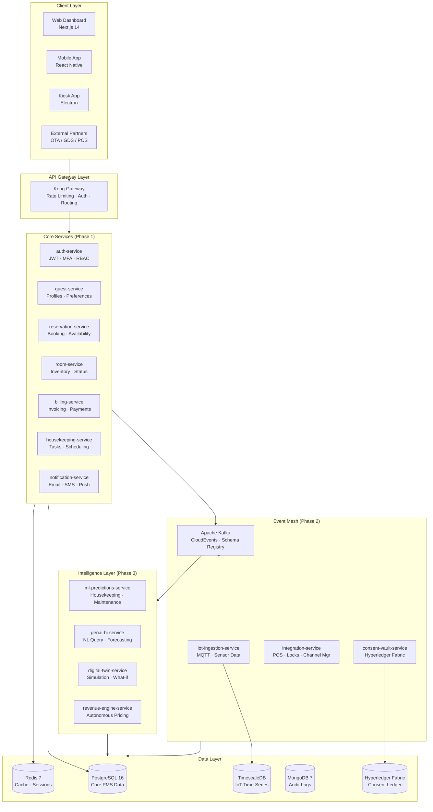
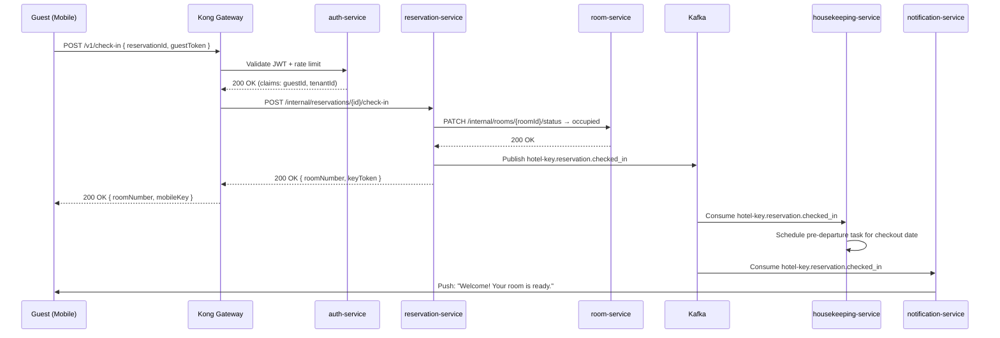

# System Architecture Overview

## Vision
Hotel Key is a multi-tenant, cloud-native hotel management platform designed for 20–10,000+ room properties. It replaces fragmented legacy PMS systems with a unified, event-driven platform where every operational signal (IoT, booking, staff action) flows through a central event mesh and powers intelligent automation.

## High-Level Architecture

## Tenancy Model
Each hotel property (tenant) is isolated via:
- **Database**: Separate PostgreSQL schema per tenant (schema-per-tenant)
- **Kafka**: Topic naming prefix: `{tenant-id}.{event-type}`
- **Auth**: JWT claims include `tenantId`; all repository queries filter by it
- **API**: Subdomain routing: `{hotel-slug}.hotelkey.io/v1/`

This avoids the overhead of full database-per-tenant while keeping data isolation strong enough for compliance. Migration to DB-per-tenant for enterprise customers is a future option.

## Request Flow — Guest Check-In

## Key Architectural Decisions

### 1. Synchronous vs. Asynchronous
- **Synchronous (REST)**: Guest-facing operations that need immediate confirmation (check-in, booking, payment). Timeout: 5s max.
- **Asynchronous (Kafka)**: All downstream side effects (housekeeping tasks, notifications, audit logs, IoT processing). Never block a guest request on a side effect.

### 2. Data Ownership
Each service owns its data exclusively. Cross-service data access is via:
- API call (for real-time, consistent reads)
- Event subscription (for eventually consistent read models / projections)

No direct cross-service database queries — ever.

### 3. Consistency Model
| Operation | Model | Mechanism |
|---|---|---|
| Room availability check | Strong | PostgreSQL `SELECT ... FOR UPDATE` |
| Reservation creation | Strong | Distributed lock via Redis + DB transaction |
| Housekeeping task creation | Eventual | Kafka event from reservation-service |
| Billing ledger balance | Strong | PostgreSQL transactions with idempotency keys |
| IoT sensor state | Eventual | TimescaleDB append-only, last-value cache in Redis |

### 4. Offline Operation
When a hotel loses internet connectivity, critical operations must still work:
- **Local edge node**: A lightweight Docker container runs on-premises with room-service and auth-service snapshots.
- **Sync queue**: All operations performed offline are queued in a local SQLite WAL.
- **Reconciliation**: On reconnect, the edge node replays the queue to the central cluster with conflict detection (last-write-wins for non-financial data; manual review for billing conflicts).

### 5. Multi-Region Deployment
- Active-active in two AWS regions (us-east-1 primary, eu-west-1 secondary for GDPR)
- PostgreSQL: Aurora Global Database (< 1s cross-region replication lag)
- Kafka: Confluent Mirror Maker 2 for cross-region event replication
- Redis: ElastiCache Global Datastore
